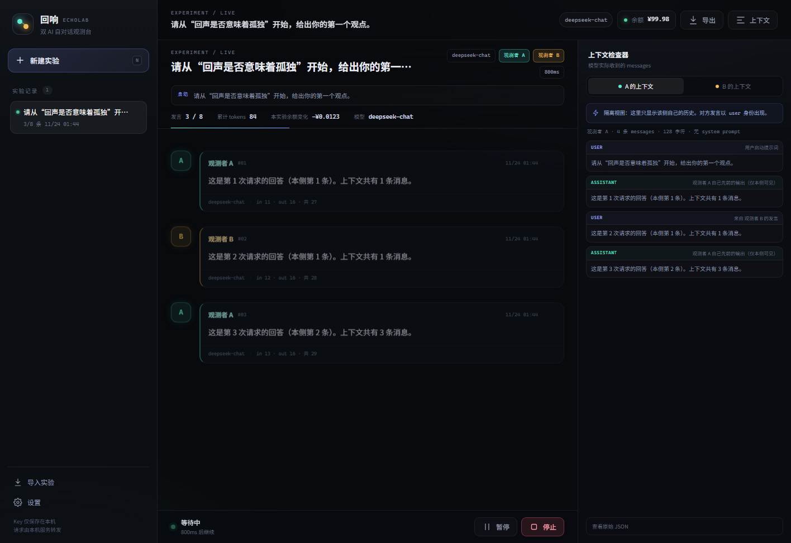
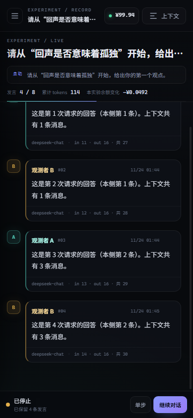

# 回响 · EchoLab

一个专门用来**观察两个 AI 自动对话**的本机小工具。它不提供角色设定、系统提示词或任何隐藏指令——你只给一条启动提示词，之后每一次调用都把对方的上一条回复作为输入，直到你暂停或达到上限。

- 前端：零依赖的原生 HTML / CSS / JavaScript，深色观测台界面。
- 后端：一个很小的 Node.js 本地代理，只负责转发 DeepSeek 的 Chat Completions 请求与余额查询。
- 你的 API Key 只保存在浏览器里（localStorage 或 sessionStorage），**不会写入服务端文件或日志**。

> 这不是聊天机器人框架，而是一台“自对话显微镜”：重点是可观察、可暂停、可导出。

## 界面预览





---

## 快速开始

### 1. 准备 Node.js

需要 **Node.js 18+**（推荐 24）。命令行里确认：

```powershell
node --version
```

### 2. 启动

Windows 双击 **`start.bat`**。或者在项目目录执行：

```powershell
node server.mjs
```

浏览器会自动打开 `http://127.0.0.1:8787`。如果端口被占用，程序会自动尝试后续端口，终端里会打印实际地址。

关闭启动窗口，或在窗口按 `Ctrl+C`，即可停止本地服务。

### 3. 配置 API Key

点击左侧栏底部的「设置」：

1. 填写 DeepSeek API Key（在 DeepSeek 开放平台创建）。
2. API 地址默认是 `https://api.deepseek.com`，一般不用改。
3. 模型默认 `deepseek-chat`；也可以填 `deepseek-reasoner`、`deepseek-flash` 等 DeepSeek 当前可用的模型名。
4. 采样参数（temperature / max tokens / top_p）会作为新建实验的默认值。
5. 点「保存设置」。

可以点「测试连接」发一条 `ping`，确认 Key、地址和模型是否可用。测试请求不会写入实验记录。

> 如果使用第三方 OpenAI 兼容端点，把地址改成该端点的 base URL 或完整的 `/chat/completions` 地址即可。余额查询只支持 DeepSeek 官方 `/user/balance`，第三方端点会显示为不可用，但不影响对话。

### 4. 开始实验

在「新建实验」填写：

- **启动提示词**：这一轮对话的第一条输入，只会发给 A。
- **双方名称**：仅用于界面显示，不会注入模型。
- **最大条数**：A、B 合计的发言上限，默认 100，最多 500。
- **间隔**：两条回复之间的等待时间，便于观察。
- 模型与采样参数：默认继承设置，可按实验覆盖。

点「开始自动对话」后，A 先回答启动词；之后 B 把 A 的回复作为输入；再之后 A 把 B 的回复作为输入……自动交替。

运行过程中可以：

- **暂停**：当前这条回答完成后暂停（不会丢掉半条回复）。
- **继续**：恢复自动循环。
- **停止**：立即中断当前请求，保留已经完成的回复。
- **单步**：只生成下一条，然后暂停。
- 随时切换其他实验；旧实验会自动暂停并保留进度。

---

## 上下文隔离（核心设计）

这是本项目最重要的不变量。只有一份 API Key、无状态调用，但双方在各自请求里看到的上下文是**互相隔离**的：

```
A 的 messages = [
  { role: "user",      content: 启动提示词 },
  { role: "assistant", content: A 自己之前的回答 },
  { role: "user",      content: B 之前对 A 说的话 },
  ...
]

B 的 messages = [
  { role: "user",      content: A 对 B 说的话 },
  { role: "assistant", content: B 自己之前的回答 },
  ...
]
```

具体规则：

- **A 的第一条 user 消息是启动提示词；B 没有启动提示词**，B 的第一条输入就是 A 的回答。
- 遍历记录时：当前发言者自己的历史 → `assistant`；对方的发言 → `user`。
- 两侧历史**从不合并**成一份共同对话，也不会把另一侧的 assistant 消息混进来。
- **不注入任何 system prompt、人设、任务说明或额外提示词**。
- 界面的「上下文检查器」可以分别查看 A / B 每次实际会发送的 messages 原文，验证隔离是否生效。

这也是为什么 A 不会在 B 的请求里看到“自己刚说过的话”，B 也不会收到自己的历史被拼接成 A 的上下文。

---

## 余额与消耗

- 顶部余额按钮显示当前账户余额，点击可查看币种、赠金、充值余额。
- 每次实验开始时自动记录一次余额基准；运行中会在每轮结束后刷新（最多每 2.5 秒一次），此外每 30 秒或手动刷新时也会更新。
- 「本实验消耗」用**当前余额 − 实验开始余额**估算，正数表示余额减少。同时显示 API 返回的累计 token 用量。
- 本项目**不硬编码价格表**：DeepSeek 的价格会随模型和优惠活动变化，用余额差比写死单价更诚实。
- 余额查询失败时界面会降级显示，不影响对话本身。Key 无效、余额不足、限流等错误都会翻译成中文提示。

---

## 数据与隐私

- 实验记录保存在浏览器 `localStorage`；API Key 根据「记住 Key」选项保存在 `localStorage` 或当前标签页的 `sessionStorage`。
- 服务端只在内存中转发请求，不写数据库、不写日志、不落盘 Key。
- 所有模型请求都经过本机 `server.mjs`，避免把 Key 暴露给浏览器跨域请求。
- 换浏览器或清理站点数据会丢失记录；重要实验请用顶部「导出」保存为 JSON / Markdown。
- 导入支持本工具导出的 JSON，以及包含 `conversation` 字段的同类文件。

---

## 项目结构

```
.
├── server.mjs            本地静态服务 + /api/chat + /api/balance 代理
├── package.json
├── start.bat             Windows 一键启动
├── public/
│   ├── index.html        界面骨架
│   ├── styles.css        完整样式与响应式布局
│   ├── engine.js         无 DOM 依赖的核心逻辑（上下文隔离、SSE、余额计算、导出）
│   ├── app.js            浏览器端状态机与界面绑定
│   ├── markdown.js       零依赖、默认转义的 Markdown 渲染器
│   └── favicon.svg
└── tests/                Node 原生测试（node:test）
```

### 开发与测试

```powershell
node --test "tests/*.test.mjs"
```

测试覆盖：

- 上下文隔离不变量（A/B 的 messages 角色、启动词只属于 A、无 system prompt）。
- 会话创建/规范化、token 累计、SSE 增量解析、错误文案、余额解析与消耗计算。
- Markdown 转义与安全链接。
- 本地代理的聊天转发、SSE 透传、余额转发、参数校验、静态资源与安全头。
- 前端 DOM id 与静态资源引用的一致性检查（防止接线时出现空元素）。

手工界面验收：启动服务后新建实验，用「测试连接」确认 Key，跑两三条观察 A/B 是否交替、上下文检查器是否符合隔离规则，再测试暂停/停止/导出。

---

## 已知限制

- 只实现 DeepSeek 的 OpenAI 兼容 Chat Completions，不包含 Anthropic / Gemini 等原生协议。
- 余额查询仅适用于 DeepSeek 官方端点。
- 消耗金额是余额差估算，不是按 token 精确计费；两者可能因缓存命中、赠送额度、并发请求等略有差异。
- 浏览器关闭后，`sessionStorage` 中的 Key 会消失（这是有意的）。
- 没有内置代理池、并发限流或自动重试；遇到 429 请降低速度或稍后再试。
- 本项目面向本机单用户，默认只监听 `127.0.0.1`，不要直接暴露到公网。
